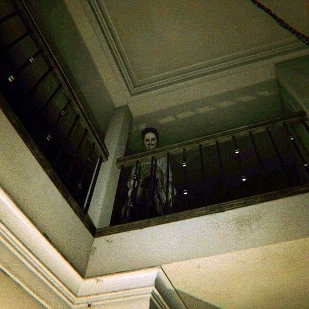
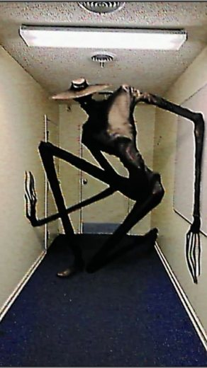
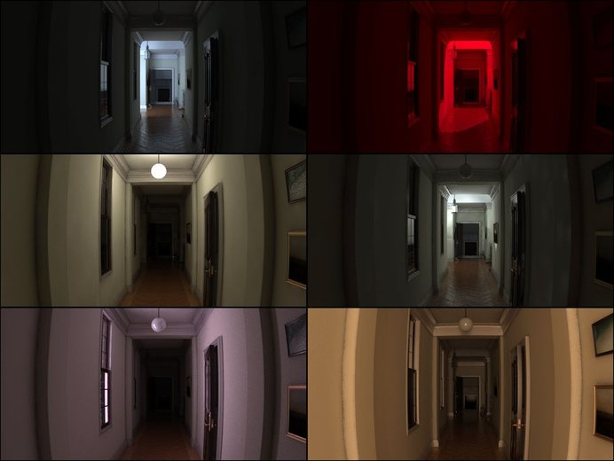
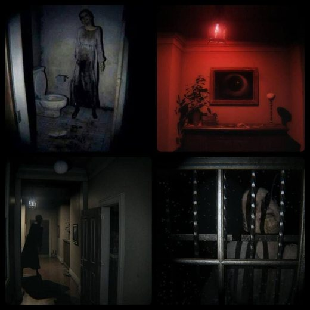
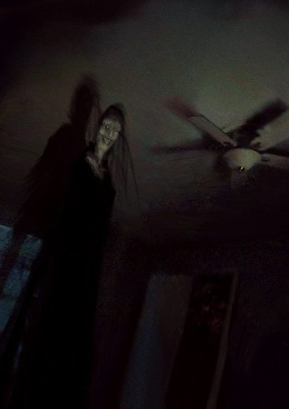
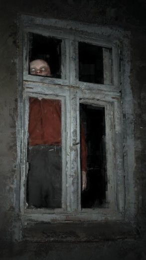

# CODEX 研究与执行规范：心里有鬼 / YOUR OWN GHOST

> 项目补充（2026-10-31）：房间主题数量开放。文中的六个现有主题及七类视觉方向是首轮样本，不是数量上限；新增用途见 [开放主题库](ROOM_RECIPES.md)。实际代码与本轮结果见 [实施计划](IMPLEMENTATION_PLAN.md)和[评审记录](REVIEW.md)。

> 版本：1.1 | 用途：在生成、组合、调整程序化 3D 房间时，让 Codex 主动联网研究影视、游戏及真实空间的恐怖视觉语法，并落实为可验证的构图规则。
> 这是**研究与房间视觉设计指令**，不是授权立即重构代码。先调查项目、提出方案和小范围预览；未经确认不得批量覆盖资产、生成大量模型或改写随机地图逻辑。

## 0. 已知项目背景与优先约束

- 游戏：**《心里有鬼 / Your Own Ghost》**；本地预览：`http://127.0.0.1:4190/?seed=1844070019`。
- 已观察到程序化房间系统、随机种子、独立事件预览、地图调试、连接房/主要事件房/短场面/喘息房、喜欢与恐惧输入等机制。这些事实来自浏览器界面的读取；**文件结构与代码实现尚未审计**。
- 已观察到 V02 氛围概念方案：旧卧室、空客厅、旧育儿室、诊疗室、旧档案室、供奉室、墙纸走廊；路径页面：`/art-source/room-presets/style/dark-scenes-v02/index.html`。概念图不等于游戏内已落地。
- 用户额外提供了 **6 张/组恐怖空间参考图（U01–U06）**，已放在 `references/user-images/`；详见第 14–16 节。图片的作品归属/原始出处尚未核实，**不可把任何图自动当作游戏可商用素材**。
- 先不要动玩法、导航、房间连通性、事件触发或已锁定的设计；重点提升**房间的空间构图、道具关系、材质与配色、光线、视线和心理恐怖辨识度**。

## 1. Codex 的角色与任务

你不是一个普通的“随机家具摆放器”，而是兼任：
1. **恐怖电影美术与摄影研究员**：搜索可靠出处，拆解镜头和场景，而不是只模仿作品名称。
2. **环境叙事关卡设计师**：把不安感映射到玩家的移动、观察、记忆与回访。
3. **程序化空间构图设计师**：把视觉语法转换成可控参数与候选组合，避免无差别随机。
4. **验证员**：对每个候选房间提出“为什么恐怖、玩家在哪看到、是否影响通行”的证据。

### 核心审美命题

**本项目特别强调“发现方式的设计”**：高处、门后、远处、天花板、窗框切割、同一走廊的照明突变。这些不首先是怪物造型要求，而是可在第一人称视角中验证的观察关系。对应用户参考图 U01–U06。


**看起来正常，但某个秩序不对。** 让玩家在第一眼辨认出房间用途，第二眼感觉东西摆错了，第三眼才怀疑建筑本身。

不靠默认满屏红光、血迹、尖叫、镜头扭曲、堆满怪物或纯黑画面制造廉价恐怖。常规房间必须允许平静、安静、甚至略带美感。**反差比持续高强度异常更重要。**

## 2. 强制联网研究流程（执行每批新房间前）

对每种待做的房间类型，先研究，后布置；禁止直接从模型记忆编造“某片某一镜头”。

### 2.1 搜索策略

按 `作品/作者 + 空间类型 + 视觉技术` 联合查询，中文与英文并行。每种房型至少检索：
- 2 条影视或游戏设计参考；
- 1 条真实建筑、室内摄影、废弃场所或民俗物品参考；
- 1 条光色、构图或镜头技术资料。

优先顺序：电影摄影/美术访谈、导演/制作设计资料、游戏开发者资料、正式出版或学术文章、官方截图与合法公开的剧照；之后才是 Pinterest、论坛和二次整理。Pinterest 可用于发现图，不可作为没有核查的事实来源。

每条参考必须记录：作品名称、场景/空间、URL、检索日期、研究到的具体机制、拟转化的规则、与原作的区别、是否可以使用原图或仅供内部分析。用户上传图的来源如果未知，必须填写“用户提供、出处未核实”，可作为**视觉灵感证据**，不得伪装成可核实影视剧照。不能访问图片时明确标记未验证，不得声称已经看过。

### 2.2 检索词字典（可直接复制组合）

```text
James Wan The Conjuring hallway negative space cinematography
James Wan Insidious house interior doorway framing horror
The Shining Overlook Hotel symmetrical framing corridors carpet geometry
Stanley Kubrick The Shining impossible hotel architecture floor plan
Twin Peaks red room production design chevron floor red curtains
Twin Peaks Black Lodge unsettling interior scale
Rusty Lake Cube Escape room symbolism object placement
Rusty Lake puzzle rooms visual storytelling props
The Backrooms liminal space fluorescent light yellow wallpaper
Kane Pixels Backrooms found footage architectural disorientation
Silent Hill P.T. hallway repetition changes environmental storytelling
Silent Hill 2 room composition psychological horror interiors
Skinamarink domestic horror framing empty corners ceiling
Hereditary dollhouse framing production design interiors
The Haunting of Hill House hidden figures background composition
KARMA The Dark World environmental storytelling interiors
abandoned hospital interior reference fluorescent institutional furniture
uncanny domestic interior off symmetry wrong scale negative space
liminal nursery empty room faded wallpaper unsettling lighting
sickly yellow green interior lighting psychological horror
surreal architecture impossible windows indoor corridors
```

对搜索结果做横向组合，不允许把一部电影里的完整房间照搬进游戏。

## 3. 必读参考流派与可执行的构图翻译

| 参考 | 研究重点 | 在本项目的转译方式 | 避免 |
|---|---|---|---|
| **温子仁系：《招魂》《潜伏》** | 门框/转角/阴影中的负空间；玩家/摄影机迟迟看不全的角落；熟悉家庭环境中的威胁预期 | 保持大多数家庭陈设正常；在入口视角布置一个可疑的遮挡点、二次视线或局部反光 | 直接复刻幽灵造型、只做 jumpscare |
| **《闪灵》** | 强轴线、过度对称、重复地毯纹理、长走廊、尺度压迫与似是而非的空间关系 | 正对称布置门/灯/椅，再在次要层级放一个不合逻辑的差异；让远处目标显得太远或太近 | 直接照抄 Overlook 酒店地毯图案或场景 |
| **《双峰》及林奇式梦境空间** | 仪式感、舞台般摆设、帷幕、重复物体、色彩互相冲突、动作逻辑延迟 | 供奉室/会客厅做重复座椅与单件异物；以少数饱和红、深绿、黑色对抗中性色 | 直接复制红房间、人物、标志图形 |
| **《锈湖 / Cube Escape》** | 普通小房间+少量带寓意的物件、不同年代的陈设并存、静物间形成谜题逻辑 | 每间房指定 1 个视觉主题物与 2–3 个呼应物，令道具彼此讲故事 | 在 3D 房间里无意义地洒一地抽象符号 |
| **后室 / Liminal Space** | 无人使用的过渡空间、功能缺失、重复模数、病态暖黄、工业日光灯 | 连接房、长走廊、候场区使用“看似合理却没有目的”的重复门洞与灯列 | 所有房间都变黄或直接复制标志性黄房间 |
| **P.T. / Silent Hills** | 同一空间回访时微小变化、门与拐角的预判、家庭物件与状态改变 | 为回访预留小幅视觉差异接口；先确认系统是否支持状态变化 | 未经过代码验证就偷偷新增循环和事件 |
| **《遗传厄运》** | 微缩模型般的构图、人在建筑里的弱小感、死板的家庭布置 | 以远景/高角度观察家居秩序；空间高低与家具大小制造不相称 | 用超大比例错误破坏可玩性 |
| **《鬼魅浮生》/《皮囊之下》及实验影像补充** | 留白、时间感、低对比、孤立人物或物件 | 将空无一物的 1/3 画面当成设计，而不是缺资产 | 完全无视觉导引 |
| **Skinamarink** | 不拍人、只拍天花板/门缝/角落，儿童尺度的家庭异化 | 在育儿室、卧室设计“玩家必须抬头或回头才发现”的角落信息 | 强迫晕眩视角或损害操作 |

**说明**：上表是设计归纳与研究方向，不代表每条都已按原始资料逐镜头核实。Codex 必须搜索验证后再引用具体镜头事实。

## 4. 恐怖房间构图语法库

每间房最多选 **1 个主语法 + 1–2 个辅助语法**；不能所有效果同时堆叠。再从第 14 节的 U01–U06 选择**至多一个显现母题**；部分房间应完全没有人形异常。

### A. 过度对称 / Ritual Symmetry
- 入门视点沿中心轴排列门、灯、座椅、画框、帷幕、床等。
- 主体近乎对称，但某一处材质、物品朝向或数量不对称。
- 适合：供奉室、档案室、长走廊、正式会客厅。
- 注意：对称是让人期待秩序；**仅有对称不够恐怖，关键是被打断的秩序**。

### B. 被遮挡的负空间 / Threatful Negative Space
- 入口视线有一块安静的大黑区、开门后的局部深处、帘后或家具背面。
- 首次观察看不清的区域，应能通过玩家移动获得信息，不能完全无意义。
- 适合：卧室、客厅、诊疗室。

### C. 不可能的尺度 / Wrong Scale
- 选择一个非关键元素略微过高、过窄、过深或摆在不合人类使用习惯的位置。
- **建筑碰撞体、门的有效净宽、天花板净高、玩家移动尺寸必须遵守项目既定规则**。
- 尺度异常优先体现在视觉装饰和透视关系，不得直接造成卡关。

### D. 重复中的异物 / Repetition with One Error
- 多个相同椅子、柜子、日光灯、画框；只有一个朝向反了、缺席或颜色不同。
- 反差由玩家辨认产生，避免让异物过于明显。
- 适合：后室、档案室、诊疗室、走廊。

### E. 不舒服的颜色 / Sickly Palette
- 让底色看似日常而略显不健康：烟草黄、灰绿、褪色粉、老旧赭红、灰蓝。
- 以材质固有色和有来源的局部照明主导，而不是全屏统一滤镜。
- 红色只在叙事需要时成为主要角色；明暗层次要保障玩家识路。

### F. 错误的日常 / Domestic Wrongness
- 桌上的杯子排列得像仪式；空椅子正对床；一组玩具全部面墙；灯亮着但没有生活痕迹。
- 所有异样都需回答：**谁会这样摆？为什么玩家会注意？**

### G. 错误的建筑逻辑 / Architectural Dislocation
- 门后另一扇门略微偏轴；走廊长度与外部视觉不一致；窗后光源不符合房间位置。
- 只做可视的心理异常，不改变地图图结构，除非明确授权。

### H. 情绪不匹配 / Emotional Dissonance
- 温柔的儿童粉色与冷硬医院灯并存；整洁餐桌与彻底废弃的大厅；漂亮图案出现在错误环境。
- 不靠恶心，而靠用途、年代、氛围和秩序相互矛盾。

## 5. 房间组合的硬性步骤

依序执行，禁止一步到位“随机摆满家具”：

1. **功能识别**：房间原本应该有什么人、用来做什么？写一句普通生活描述。
2. **入口镜头**：记录玩家进门方位、视高、视野、第一眼所见及主要消失点。
3. **主焦点**：1 个显著建筑/家具焦点；不要堆多个互相争抢的主角。
4. **空间层次**：前景遮挡、中景行为暗示、远景引导或深层空白至少三层。
5. **物件分组**：按真实使用功能放置 2–4 组可理解的物件簇，再引入 1 个违反预期的关系。
6. **恐怖语法选择**：从第 4 节选 A–H 组合，标记其主次。
7. **光色决定**：明确光源在何处、有何物理或故事理由；确保至少一条可靠导航线索。
8. **第二视点检验**：玩家移动两三米或回头后，图像是否产生新含义？另需标明“第一次视线、发现点、确认点”；如果使用 U01/U04/U05/U06 的遮挡显现，必须能在游戏允许的玩家视角下实际看到。
9. **通行与遮挡校验**：门不被堵、动线可辨、事件触发视线与交互目标可达。
10. **截图并评级**：每个候选至少保存入口、房间中央、回望出口三种视图。

### 推荐的视觉权重（设计目标，非现存系统参数）

- 60–75%：正常可信的房间基础与实用物件；
- 15–30%：构图、光色、遮挡、重复带来的轻微异常；
- 5–10%：明确的叙事符号或视觉冲突。

同一层不要让所有房间都是异常高峰。可用大约 **普通连接房 → 怀疑房 → 明显异常事件房 → 短暂喘息房** 的节奏，但最终分布服从既有地图和事件配置。

## 6. 针对现有七种房间的初始视觉配方

| 房型 | 主构图 | 物件关系 | 颜色与光 | 第二眼异常 |
|---|---|---|---|---|
| 旧卧室 | 床偏离中心轴、门框压住视线边缘 | 一把椅子面向床、床边灯、相框 | 旧奶油白+灰褐，单个弱暖灯 | 相框方向/椅子与床的距离不合生活逻辑 |
| 空客厅 | 宽大空白中心、沙发远置 | 桌、座椅与落单落地灯 | 暗绿/灰棕，局部低照度 | 家具组成一个缺席人物的位置 |
| 旧育儿室 | 低尺度视线+天花板空白 | 婴儿床、玩具排列、矮柜 | 褪色粉/病态黄绿，柔光混冷光 | 玩具集体面墙或每件朝同方向 |
| 诊疗室 | 近乎临床对称 | 检查床、托盘、折叠屏风、空椅 | 冷灰绿+荧光白 | 屏风后出现视觉上不可能的深度 |
| 旧档案室 | 书架重复透视到深处 | 档案盒按一套规则排列 | 烟草褐/灰绿，单列顶灯 | 一列档案盒过度整齐或有空缺 |
| 供奉室 | 严格中轴+夸张空地 | 椅子/烛台/布幔构成仪式关系 | 深红褐与近黑，少量静态暖光 | 供奉对象缺席，座位却像在等待 |
| 墙纸走廊 | 强一点透视+重复门洞 | 纸纹、门、灯距逐次重复 | 褪色黄、灰绿、冷白荧光 | 最后一扇门或灯的位置略不合规律 |

这些是待研究和预览的**候选设计**，不是要求立刻覆盖目前概念图。既有 V02 概念图风格优先作为一致性基底。

## 7. 研究证据与产出文件格式

每轮研究在仓库中建议建立（如已有结构，遵从现有命名）：

```text
docs/art/horror-art-direction/
  REFERENCES.md              # 影视/游戏/建筑研究与链接
  COMPOSITION_GRAMMAR.md     # 恐怖空间语法，参数与反例
  ROOM_RECIPES.md            # 各房型候选配方、主次关系
  IMPLEMENTATION_PLAN.md     # 与实际项目代码映射、风险、阶段
  QA_恐怖房间生成审美检查清单_v1.1.md   # 本套独立检查清单
  references/user-images/    # U01-U06 用户提供原图 + preview 缩略图
```

### 每条研究记录模板

```yaml
reference_id: REF-001
source_title: "The Shining"
source_type: "film | game | architecture | interview | cinematography"
url: "https://..."
accessed_at: "YYYY-MM-DD"
source_confidence: "primary | secondary | inspiration-only"
exact_scene_verified: false
spatial_pattern: "axis symmetry / repeated thresholds"
psychological_effect: "expectation of order; tension from one discrepancy"
room_application: "corridor / archive"
implementation_hint: "align 4 door modules; shift one non-critical prop"
not_to_copy: "specific recognizable carpet and set design"
license_note: "reference-only; no asset reuse permission implied"
```

### 每个房间配方应至少提供

- `room_id` / 现有房型 ID，不得擅自假设 ID;
- 入口方向、关键相机观察点；
- 主情绪（如被注视、空荡、仪式、错位）；
- 构图主语法及辅助语法；
- 主焦点和三组物件簇；
- 视线遮挡区域、灯位和色彩板；
- 1 个可被玩家发现的异常；
- 与其他房间的差异及密度控制；
- 所借鉴参考的可靠链接；
- 走通检查和预览路径。

## 8. 程序化接入原则（需先审计实际代码）

**先读项目，再决定接入点**，绝不凭空假设使用 Three.js、React、Godot 或某个房间 schema。

建议将恐怖表现作为“叠加层”而非改写地图拓扑：

```text
existing room graph / seed / gameplay
             ↓
room function + entry orientation
             ↓
composition preset (authored)
             ↓
prop clusters + color/light recipe
             ↓
one selected anomaly
             ↓
collision/nav/visibility validation
             ↓
render preview + seed regression check
```

如果项目已有 preset、scene variant 或 object catalog，则**复用既有机制**；只有查明无法满足需求时才提最小扩展。

### 推荐的可控字段（仅概念，不是直接修改现有 JSON）

```json
{
  "mood": "ritual_unease",
  "composition": "near_symmetry",
  "focal_object": "empty_chair",
  "prop_clusters": ["ceremonial_seating", "side_table", "curtain_wall"],
  "anomaly": "one_chair_facing_wall",
  "palette": "deep_brown_muted_red",
  "lighting": "practical_warm_islands",
  "camera_beats": ["entry", "center", "look_back"],
  "preserve_navigation": true
}
```

不要原样写入代码；先匹配真实数据模型。随机选择必须服从房型与剧情意图，而非均匀随机；既有种子在同版本下应可复现。

## 9. 严格质量门槛

本版新增**独立逐房复核文件**：`QA_恐怖房间生成审美检查清单_v1.1.md`。评分不代替实机观察；存在碰撞堵塞、无授权替换资产或种子不可复现等阻断项时，一票否决。


每个预览按 0–5 分评估：

| 维度 | 5 分标准 |
|---|---|
| 生活可信度 | 一眼看出房间原用途与家具关系 |
| 空间构图 | 有明确主轴/焦点/前中后层次 |
| 不安辨识度 | 不依赖血或怪物仍让人觉得哪里不对 |
| 独创性 | 可说出借鉴原理，但不易认成某一影视场景复制品 |
| 游玩可读性 | 玩家知道能走哪、该观察哪且不会卡住 |
| 房间差异 | 与相邻房间具有明显的节奏和视觉差别 |

**不得通过**：只有黑、纯随机乱摆、光源无来由、家具悬浮、尺度与碰撞错误、把参考场景直接照搬、断裂导航、每个房间千篇一律。

推荐每批只做 2–3 个有明显区别的候选，并保留原方案。由开发者确认后再批量生成资产与接入。

## 10. 本次 Codex 首轮任务：先调查，暂不批量改造

请按以下顺序执行：

1. 找到项目实际源码根目录，读取 README、相关美术规范、房间生成器、预设/manifest、道具表、地图生成/事件分配逻辑。
2. 检查 `seed=1844070019` 的预览与对应房型；分清实际 3D 实现、静态概念图、仅有灰盒的地方。
3. 联网搜索本规范第 2–3 节及第 14 节的参考，至少输出 12 条**有来源可查**的研究记录，涵盖电影、游戏、真实空间。
4. 基于现有七种房型列出每种 2 个不同的恐怖构图方向，并指出是否使用 U01–U06 中的视线母题，标注风险与需要新增的资产。
5. 选择 **旧卧室、墙纸走廊、供奉室** 三个代表性房间先写详细构图配方，展示三种不同的恐惧机制；尽量复用现成资产。
6. 生成改造计划（具体文件、最小改动点、是否涉及碰撞/导航、回归步骤），先提交报告，不要擅自执行大批量重构或覆盖素材。
7. 如果获得实施授权，再做 A/B 预览，用同一种子回归：房间结构不变、玩家可通行、事件仍能触发、房间恐怖语言明显提升。

## 11. Codex 最终汇报格式

```text
A. 项目真实现状（读过哪些文件，证据位置）
B. 联网研究报告（至少 12 条来源；区分已验证与待验证）
C. 7 种房型视觉方向对照
D. 3 个重点房型完整构图说明
E. 与现有技术架构的映射和最小开发计划
F. 测试/截图/种子验证方案
G. 风险、未解决的问题、下一步最小建议
```

## 12. 推荐核查来源与起点

以下是真实可访问的研究起点；每次执行时应重新检索更新并扩展，而不是只依赖本文件。

- 《闪灵》建筑与悖论空间研究：<https://www.lacuestionuniversitaria.upm.es/index.php/proyectos_arquitectonicos/article/view/4833>
- 《闪灵》地毯与室内图案解读：<https://mediacommons.org/imr/content/ornaments-horror-kubrick%E2%80%99s-carpet-wallpaper-and-rococo-survival>
- American Cinematographer：《Backrooms》的摄影与光照：<https://theasc.com/article/backrooms-cinematography-cox/>
- Fast Company：《Backrooms》制作设计：<https://www.fastcompany.com/91549406/a24-backrooms-film-production-design-liminal-space>
- 后室与阈限空间学术研究 PDF：<https://scholarworks.iu.edu/journals/index.php/cl/article/download/41598/43424/121004>
- Rusty Lake 官方站点（待逐游戏展开）：<https://www.rustylake.com/>

## 13. 最终设计禁令

- 禁止未经批准删除/覆盖现有 V02 概念图、预设或原始资产。
- 禁止直接复刻他人受保护的具体场景、地毯纹样、标识、角色与美术资产；只研究可迁移原理。
- 禁止把搜索图片默认视为可用于游戏发行；记录许可与来源；本套 U01–U06 也仅供研究与内部构图分析。
- 禁止将 U02/U04/U05/U06 中的具体人形、面孔、服装、肢体剪贴或 1:1 重建进游戏；学习的应是视角、遮挡、光色、尺度关系与发现节奏。
- 禁止使用不可靠资料伪装成“导演原话”或“已验证镜头”。
- 禁止为恐怖牺牲交互可读性、帧率、碰撞正确性与演示版本稳定性。
- 禁止为了所谓掉 SAN 感进行持续闪烁、强烈摇屏或高频条纹刺激；允许提供降低动态/视觉刺激的选项。

**最终目标不是生产一堆“恐怖物件”，而是生产一系列让玩家觉得“自己认识这里，但这里不认识自己”的房间。**


---

## 14. 用户参考图母题库 U01–U06（v1.1 新增）

**阅读约定**：以下图片由项目开发者在本轮对话中提供；它们的原始作品、摄影者、剧照出处、许可状态均**未验证**。文字只陈述图片中可见的构图特征，不认定来自某部电影或游戏。只把图像作为**研究与原理抽取的参考**，不能直接进入游戏素材包。图片缩略图与原图均包含在本 MD 同级 `references/user-images/` 中。

### U01 — 高处凝视：玩家被建筑中的另一个视线俯视

[查看原图](references/user-images/U01_高处栏杆_静止凝视.png)



- **可见画面**：低角度拍摄通往二层的挑空空间；厚重梁柱与栏杆切割画面，上方暗处有人影俯视。人影不是画面唯一主体，先有建筑层次，再有被发现的人。
- **恐惧来源**：竖向盲区、视线等级差、远处静止的人形、玩家自觉“晚于对方发现”的心理落差。
- **适用空间**：楼梯间、带夹层的门厅、二层回廊、旧旅馆中庭；**仅在项目已有合法层高/几何支持时**启用。
- **落位方式**：从预定入口观察点出发，人物/轮廓位于抬头才能发现的上层 1/3 位置；栏杆必须遮挡身体一部分；保留顶部暗面但让脸/肩或衣服有足够轮廓区别。
- **发现节奏**：进门看见大厅（第一眼）→ 玩家自然向上观察（第二眼）→ 通过转身/抬头确认人影（第三眼）。可以是**纯环境摆设/视错觉预留位**；是否出现实体角色由事件系统授权。
- **低资产替代**：空衣服、椅背、挂饰与栏杆投影组合，形成“似人非人”的远景；不要偷偷新增敌人逻辑。
- **禁忌**：把人物放在玩家进门正中央全亮展示；凭空增加可进入二层或破坏房间图连通性。

### U02 — 狭窄通道里的不相容形体：空间在拒绝容纳它

[查看原图](references/user-images/U02_狭窄走廊_异常肢体.png)



- **可见画面**：规则、狭窄、日常的浅色走廊，被过长、折叠并越过人体常规关节关系的黑色形体占据。天花板、灯具、门和墙提供可靠的尺度尺。
- **恐惧来源**：正常建筑尺度与不正常形体之间的冲突；走廊无法让人避让时产生的封闭感。
- **适用空间**：服务通道、诊疗室后走廊、衣柜间、狭小储物房、非主干过道。
- **落位方式**：优先把它定义为**仅在指定事件中使用的威胁构图候选**，默认不得当作随机常驻家具或障碍物。身体与门、天花板之间必须有可读的尺寸对照。
- **仅做环境美术时**：改为“过长的衣架/金属支架/椅腿/管线的关节方向异常”，保留肢体感但不生成具体怪物。
- **禁忌**：直接复刻图中造型；随机把超长肢体放进所有连接房；真实碰撞体堵死玩家；把模型穿模错误误当作设计。

### U03 — 同一个走廊，仅改光色和亮度：视觉对照实验

[查看原图](references/user-images/U03_同一走廊_光色矩阵.png)



- **可见画面**：几何结构、门洞、地板和透视基本一致的走廊，排列为多种照明/色温版本；其中包括强烈红光、冷亮区域、偏暖与偏紫的状态。
- **恐惧来源**：熟悉的路径不变，但颜色使它像另一处空间；日常灯具不再提供正常的安全感。
- **适用空间**：墙纸走廊、同种连接房的不同情绪状态、回访场面。
- **实验要求**：以**同种子、同房型、同相机坐标、同家具**先对比 3–4 个光色变体；不要一边换灯一边换几何，导致无法判断效果。
- **方向建议**：A 自然偏冷（基线）/ B 老旧暖黄（不适）/ C 暗绿灰（病态）/ D 局部红光（高峰或事件），按叙事强度选择。**全红应非常少见，且必须说明灯光来源**。
- **禁忌**：用全屏 RGB 滤镜掩盖缺乏光源布置的问题；把游戏每条走廊都设成同一种红/黄；牺牲门、墙角和通路的辨识度。

### U04 — 四种“局部显现”：不必把异样放在画面中心

[查看原图](references/user-images/U04_生活空间_局部显现四宫格.png)



这是一张**四宫格组合图**，需要分别分析，不要粗略贴上“恐怖场景”标签：

| 子参考 | 可见关系 | 可迁移的空间规则 | 常用房型 |
|---|---|---|---|
| **U04-A 左上** | 厕所/狭窄房内，人物靠近墙面，玩家从门外看见 | **门框后的人形**：开门状态、墙角与视线重叠制造压迫 | 旧卧室的附属浴室、诊疗室、狭小厕所 |
| **U04-B 右上** | 红色局部照明照亮一小段墙面和画框/家具 | **颜色先于信息**：引导玩家看向似乎无意义的墙面物件 | 空客厅、供奉室、档案室 |
| **U04-C 左下** | 走廊中远处出现模糊人形，门框遮挡局部空间 | **末端目标与深度不确定**：让玩家怀疑远处黑影有没有靠近 | 墙纸走廊、连接房 |
| **U04-D 右下** | 窗格/栏栅后方出现不完整身影 | **几何切片**：利用栏杆遮挡让玩家从多次侧移中拼出形体 | 诊疗室、档案室、窗边 |

- 这四种方式的共同点是**建筑先建立信息可见范围**，异样再进入观察范围。
- 允许只使用门、画框、黑影或灯，而不一定摆放真正的恐怖角色。
- 未获事件设计授权前，**不要自动添加可移动威胁或跳脸事件**。

### U05 — 抬头才见的天花板异物：日常房间的上方禁区

[查看原图](references/user-images/U05_天花板_倾斜视角与影子.png)



- **可见画面**：昏暗室内，天花板和吊扇是空间标尺；高处出现拉长的人影/暗影，画面视轴明显倾斜。
- **恐惧来源**：人对“头顶通常安全”的默认认知被颠覆；上方异常结合巨大的影子，把房间拉长成难以掌握的空间。
- **适用空间**：旧卧室、旧育儿室、楼梯平台、小型起居室。
- **环境化替代**：风扇投影与垂挂衣物造成似人轮廓、灯罩阴影不合常理、天花角落出现与家具不对应的形状。
- **视点注意**：角色可以自然抬头；**不可强迫长时间大幅倾斜摄像机或高速摇屏**。预览要用真实游戏视高与可操作俯仰角验证。
- **禁忌**：到处乱放漂浮角色并解释成“超现实”；阴影方向与光源不匹配却没有叙事理由；看不清通行路径。

### U06 — 窗格切割人物：玩家只能看到被建筑允许看到的部分

[查看原图](references/user-images/U06_旧窗框_人物局部遮挡.png)



- **可见画面**：老旧多格窗框遮住人物大部分轮廓；仅一部分面部、衣服和手臂分别落入不同格内，黑暗补足空白。
- **恐惧来源**：大脑试图在多个窗口之间拼出“完整的人”，却难以确认人物的姿态、尺寸和所在深度。
- **适用空间**：旧档案室的门上观察窗、旧住宅窗、诊疗室隔离窗、门板玻璃、柜门小窗。
- **落位方式**：先确定玩家能站的位置和能移动的距离，再调整格栅宽度、窗框高度、前后景亮度，使至少两个不连续部分能够被辨认。
- **首选优化**：窗后保持较暗，窗框在近景形成实体遮挡；侧向移动产生视差，让玩家意识到窗后真的有空间。
- **技术禁忌**：不要通过模型穿墙/穿玻璃制造“分割效果”；必须使用明确遮挡几何、正确深度排序和适当碰撞/禁入边界。

### 六张图如何组合，而不变成一堆廉价惊吓

- **空间主张先行**：U01/U05 解决“上方未知”，U04/U06 解决“被遮挡的未知”，U02 解决“尺度冲突”，U03 解决“同一空间的情绪变化”。
- **一房一意图**：单间选择一个显现母题或完全不使用。不要“窗里有脸 + 天花板有鬼 + 走廊尽头有怪 + 红光”同时发生。
- **连接房**：多数只用 U03 的照明微差、U04 的负空间、U06 的空窗框；不需要真出现人。
- **事件房**：需要事件配合时才使用 U01/U02/U05/U06 的明确人形；出场与否及行为必须由已有场面配置决定。
- **喘息房**：可以建立秩序、清晰光源和日常物件。它的“普通”是下一次恐惧的条件。

## 15. 把“恐怖发现方式”变成程序化构图约束（v1.1 新增）

**程序化房间 ≠ 在可用空格里随机放道具。** 先确定玩家从哪里进入、看向哪里，再放有意义的物件关系。真实实现时必须先检查已有场景结构，以下字段仅为**研究/设计中间格式**，不是要求立即改数据模型。

### 15.1 三个发现时刻

1. **正常认知（Recognize）**：玩家 1–2 秒内识别房型与基本通路，例如“这是一条普通旧走廊”。
2. **局部怀疑（Notice）**：某个靠高处、末端、窗格或门框的异常需要玩家转头、靠近或第二次看才可能注意。
3. **感知证实/失效（Recheck）**：玩家移动 1–3 米或回望时能获得新的遮挡关系；允许信息仍然模糊，但不允许纯渲染错误或不可见摆设。

时间与距离是**设计观察窗口示例**，不是在未经测试情况下写死到玩法脚本。

### 15.2 先规划锚点，再选择资源

每个房间在组合家具前写一份“视觉锚点表”：

| 锚点 | 作用 | 检查 |
|---|---|---|
| `entry_view` | 玩家进入时的自然视线方向 | 玩家真实机位/FOV，不能用自由飞行摄影机代替 |
| `primary_axis` | 主门、床、灯或走廊消失点 | 是否一眼能够建立空间用途 |
| `occluder` | 前景门框、帘、栏杆、窗格 | 是否真的形成可重复的遮挡 |
| `anomaly_anchor` | 唯一显现点或轻微错位 | 是否与 U01–U06 某一母题有关、是否过分显眼 |
| `recheck_view` | 玩家二次确认的自然站位 | 不要求玩家穿墙、跳跃或精确卡像素 |
| `safe_path` | 正常通往出口的连续路径 | AI 摆物不可阻断；威胁事件另由既有逻辑决定 |

### 15.3 一份可提交审查的示例配方

```yaml
# DESIGN EXAMPLE ONLY — NOT AN EXISTING GAME SCHEMA
room_id: "VERIFY_IN_PROJECT"
seed_for_review: 1844070019
room_archetype: "corridor"
normal_function: "旧住宅走廊，连接两间房"
visual_question: "窗格后是否有人站着？"
reference_card: "U06"
primary_grammar: "obscured_presence"
secondary_grammar: "repetition_one_error"
entry_view: "从当前房间实际入口看向尽头"
anomaly_anchor: "尽头侧墙的一扇带格小窗，位于视线边缘"
occluder: "真实窗框实体"
recheck_view: "靠近后侧移半步能看到不同的轮廓片段"
light_logic: "走廊一盏偏暖旧灯；窗后低亮度"
asset_fallback: "不放人形，只放窗框 + 后方衣物轮廓"
required_validation:
  - "同一种子重放构图一致"
  - "窗框没有破坏碰撞/门扇"
  - "玩家可自然看到第一、第二视点"
  - "不影响出口和事件触发"
  - "无遮照/光照闪烁等可访问性风险"
copy_prohibited: "用户参考中的具体人物和窗框一比一重建"
```

### 15.4 视觉随机化只允许发生在可控层

- **可随机**：同语法的不同美术资源、轻微朝向、灯具材质、单个物件缺失、由人工设计过的锚点预设、低风险调色。
- **有条件随机**：轮廓是否显现、窗后是否有人影、环境异常状态变化——必须受已有**事件/剧情状态、房型和节奏密度**约束。
- **不得随机**：玩家入场方向、门的有效宽度、事件触发点、地图连通、重要交互物可达性、角色身体大小与敌人行为协议。
- **优先预设选择，而非无限排列**：3–5 个有作者控制的构图候选，通常胜过 100 个没有视觉节奏的随机道具组合；数量是建议，不是系统既有值。

### 15.5 房型 × 参考母题：首轮候选（必须核对实际资产）

| 房间 | 最优先的母题 | 低成本落地思路 | 暂勿做 |
|---|---|---|---|
| 旧卧室 | U05 + U03（弱光） | 天花投影与门边半遮挡衣物 | 无事件许可就固定在天花板生成鬼 |
| 空客厅 | U04-B + U01（有挑空时） | 灯色不舒适 + 错位沙发/空位 | 擅自新增二层可玩区域 |
| 旧育儿室 | U05 + U04-A 的门框机制 | 玩具与吊饰投影、偏低视线的门框 | 同房塞满怪物或血迹 |
| 诊疗室 | U04-A / U04-D | 屏风后轮廓、观察窗、器械重复 | 通过穿模伪造异常 |
| 旧档案室 | U06 + U04-C | 书架形成观察缝隙、远端人形错认 | 堵塞档案交互区 |
| 供奉室 | U04-B + 对称语法 | 暗红色局部照射空供台 | 直接照抄《双峰》红房间 |
| 墙纸走廊 | U03 + U04-C | 同构图多灯色状态、尽头不确定阴影 | 所有走廊常亮红灯或随机刷怪 |

**注意**：U02 的异常肢体与 U01 的具体人形显现，默认放在**可选事件设计库**，不是七种房型的普遍装饰规则。

## 16. Codex 自动审美复核与交付流程（v1.1 新增）

### 16.1 两档执行模式

- **完整研究模式**：遵循前面的联网研究 12 条参考、7 房型对照、3 房细化、A/B 预览。
- **小批快速模式**：先读已有研究和 U01–U06，针对当批待做的 1–3 间房补充少量定向检索；**不因“收集资料”拖延可玩 Demo 的稳定性**。仍需记录真实来源和授权边界，禁止臆造检索事实；无法联网则明确列出“待验证”，先用已获授权的自有原型资料做设计。

### 16.2 每个候选房间必须交付的最小证据

1. 一句正常功能描述 + 一句恐怖问题（例如“窗后是不是有人？”）。
2. 一个构图主语法 + 最多一个用户显现母题编号 U01–U06（也允许空值）。
3. 物件簇和主要光源的位置解释（不是只列资产名）。
4. `entry` / `notice` / `recheck` 三个第一人称观察点。
5. 与同一房型**未改版**对照的截图；灯色 A/B 必须固定几何与机位。
6. 同种子 2 次重放、门/碰撞/事件状态检查，并记录结果。
7. 独立 QA 文档的 P0 阻断项 + 审美评分；需要人为确认的项保留“待确认”，不能擅自写 PASS。

### 16.3 每次生成/调整房间的停机条件

- 房间变成纯黑、没有方向线索；
- 道具重叠/穿模被当作“超现实设计”；
- 风格过度变成统一红光、统一鬼影或所有房间同样强烈；
- U02 的肢体造型被无授权塞进连接房；
- 发生门堵塞、碰撞错误、事件触发失败、种子不复现或明显性能下降；
- 编写了无法核查的影视出处或错误宣称用户参考图片可直接商用。

### 16.4 建议的 Codex 输出结语

```text
房间 ID / 种子 / 房型：
正常功能一句话：
心理恐怖命题一句话：
用户图 U01–U06 显现母题（或无）：
实际查阅的外部参考来源（已核实/未核实）：
视觉锚点（入口/主轴/遮挡/异常/再确认）：
实际放置的道具簇与灯光：
为什么不是普通随机家具房：
为何区别于旁边房间：
同机位 A/B 图片路径：
程序回归结果：
审美 QA 总结（阻断项 / 分数 / 人工待确认）：
改动文件及回滚方式：
```

> **必须联合使用**：`QA_恐怖房间生成审美检查清单_v1.1.md`。它是每间房的验收单，不是装饰性附录。没有审美验收与技术回归的候选，不能标记“已完成”。
