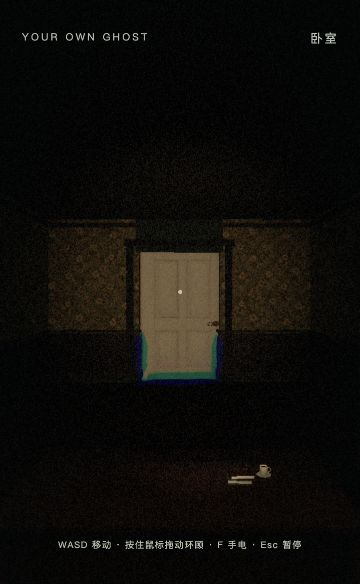
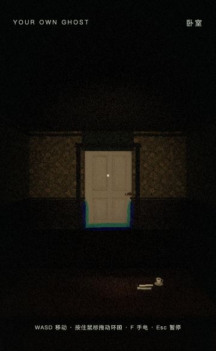

# 首轮研究与候选验收记录

日期：2026-10-31。首轮资料和设计完成，三项候选尚未实施。以下状态将文档完成、数据检查、浏览器观察和人工验收分开。

## 已执行检查

| 检查 | 结果 | 范围 |
|---|---|---|
| 15 个包内文件导入 | 已导入 | 3 个 Markdown、6 个原 PNG、6 个预览 JPG；文档路径/措辞适配见 IMPORT_MANIFEST |
| 6 组原图查看 | 已逐张查看 | 不推断作者、作品归属或动态行为 |
| 12 条联网来源 | 已打开页面、形成记录 | 只验证文中列明的事实，不宣称逐镜头验证 |
| 相同种子两次生成 | PASS | 默认菜单和 none/generic 两组配置；两层完整计划相同，见 SEED_AUDIT |
| 运行 catalog 资源路径 | PASS | 36 个模型路径存在；不是全模型解码或包围盒验收 |
| 游戏浏览器观察 | 已进入卧室 | Codex 内置浏览器、macOS、窄竖向视口；拖动模式、E 起身；看到真实墙纸、门、桌面物和 VHS 画面 |
| 构建和测试套件 | PASS | 同步后 `npm test -- --test-concurrency=4`：167/167，无失败/取消/跳过，约 118 秒；`npm run build` 通过，有既有 >500 kB 包体积提示 |
| 真人试玩 | 未执行 | 不宣称试玩验收 |

## 游戏基线

地址：`http://127.0.0.1:4190/?seed=1844070019`。喜欢跳过，恐惧通用占位，第一层；初查 UI planHash 为 `c3d84a7e`，与初查 Node 诊断一致；同步后为 `e7595c71` / `639ffada`，见最新 SEED_AUDIT。按 E 起身后在出生点截取画面，未移动到门外；手电和 VHS 保留游戏当时状态，VHS 菜单显示约 0.6。

画面中的门可认，四周与上方较暗；窄视口下不能凭此判断床和三个层次是否完整可见。此图是本地未提交美术工作区的观察证据，不是新候选效果图，也不是 entry/notice/recheck 全套对照。未测帧率，不根据截图判断运行性能。

## 三个试点 P0 检查

| 阻断项 | 卧室 | 通道段 | 供奉室 |
|---|---|---|---|
| 既有计划可重复生成 | PASS 数据层 | PASS 数据层 | PASS 数据层 |
| 候选重入两次画面确定 | NOT IMPLEMENTED | NOT IMPLEMENTED | NOT IMPLEMENTED |
| 候选门、通路、交互与触发实走 | UNKNOWN | UNKNOWN | UNKNOWN |
| 候选外形/碰撞/接缝正确 | UNKNOWN | UNKNOWN | UNKNOWN |
| 候选尺度与实际模型支撑 | UNKNOWN | UNKNOWN | UNKNOWN |
| 本次无新增敌人、碰撞或全局效果 | PASS 变更范围 | PASS 变更范围 | PASS 变更范围 |
| 本次无修改事件与图连接 | PASS 变更范围 | PASS 变更范围 | PASS 变更范围 |
| 候选性能与显示可读性 | UNKNOWN | UNKNOWN | UNKNOWN |
| 参考图无运行复用、既有资产未覆盖 | PASS 变更范围 | PASS 变更范围 | PASS 变更范围 |
| 玩家三观察点与 A/B 齐全 | UNKNOWN | UNKNOWN | UNKNOWN |

“PASS 变更范围”仅表示本轮没有修改对应运行内容，不能为未来候选背书；数据层可重复也不能代替实走和图像复现。

## 六维评分与状态

六维为生活可信度、视角构图、心理不安感、物件叙事关联、房间节奏差异、游玩可读与原创。没有候选实景，全部 UNKNOWN，不计算平均分，不以文字方案自评 4 分以上。

| 候选 | 六维评分 | 当前结论 | P1 与 P2 待处理 |
|---|---|---|---|
| bedroom 日常关系 | UNKNOWN × 6 | NEEDS HUMAN REVIEW，NOT IMPLEMENTED | P1：床与书杯是否能被自然看见；P2：空白是否足以产生意义 |
| 第二层 room-1 通道灯色 | UNKNOWN × 6 | NEEDS HUMAN REVIEW，NOT IMPLEMENTED | P1：中央桌体旁通行与出口可读性；P2：灰绿是否仍保留墙纸色层 |
| 第一层 room-1 供桌缺位 | UNKNOWN × 6 | NEEDS HUMAN REVIEW，NOT IMPLEMENTED | P1：环形路径转至南侧后才能见供桌；P2：缺位是否能与普通没摆满区分 |

下一步最小建议：先实施卧室一组桌面关系并补齐三观察点，再决定是否推广；通道与供奉室保持独立候选。人工负责人意见：尚未收到。

同步复核：最新提交 1f3085e 下，两组输入配置各重复生成两次仍一致；主题与事件的跨版本变化已反映到试点配方。初查图片保留作为版本明确的历史基线，不冒充更新后的画面。

更新后的实际浏览器复核：已重新进入 1f3085e 的相同种子、none/generic 输入，UI 为 e7595c71，拖动模式起身成功。下图仍是出生点观察，没有走完三试点路线；与初查图跨版本，不能当单变量 A/B。

当前菜单另显示主要单元 3/4，这是更新后该种子的内容覆盖提示；本次没有修复或承诺其全剧情验收，后续交程序方判断，不影响主题研究资料导入。
