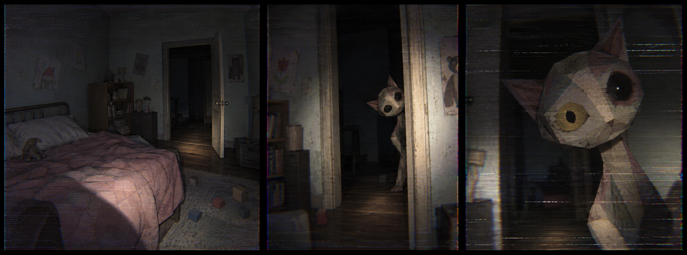

# 恐怖元素美术框架：旧屋中的熟悉异物

日期：2026-10-31。版本：v1。责任方：chen 美术。

本轮根据用户提供的参考修改恐怖元素的视觉组织方式，覆盖 CAT01、28 项基础场面与 28 个扩展剧本。本文是美术设计与程序交接依据，画面及资产需求尚待制作验证。事件条件、旁白、死亡复位与跨层事实继续依据[剧本总集](../script-catalog.md)；整体范围参见[游戏设计文档](../game-design-v0.2.md)。

## 1. 创作核心与参考职责

**在一间有生活痕迹的旧屋里，熟悉的东西开始用不合常理的姿态、距离和时机回应你。**

玩家先认出卧室、猫、椅子、照片，再逐渐发现它们之间的关系不对。日常空间越可信，局部失常越有力量。主要视觉母题是“门框或家具边缘露出的局部”；辅助母题是“仍然空着的位置”和“能够认出是同一件东西的残留痕迹”。这些母题服务具体剧本，不为每间房强加一个窥视者。

参考为用户于 2026-10-31 提供的三联静态图，原图 2056 × 765，约 2.1 MB。此处仅作为设计对照资料保存，未加入运行时资源。图片未附来源、作品名称或角色身份信息，本文不推断其出处或权属。

| 图中可观察的内容 | 本项目的设计转译 |
|---|---|
| 铁床、褪色被褥、旧木家具、墙上儿童画、积木构成生活环境 | 环境先建立被使用过的可信感；儿童物件可用于卧室，不据此设定玩家年龄或强加童年创伤故事 |
| 猫形角色有明显折面、斑驳表面、歪头与不对称眼部 | 异物保留可辨认物种，选择一两处比例或动作失衡；手工拼接、旧布或涂绘是制作推导，静态图不能证明真实材质 |
| 门框遮挡身体，黑暗中露出头与躯干的一部分 | 用遮挡和站位控制信息显露；关键事件仍须在合法观察区看清 |
| 三幅画面的景别由房间到门边再到面部，局部光照揭示形体 | 把“远处认出、接近发现异常”作为美术距离设计；不将静态三联图断言为已知动画或强制游戏运镜 |
| 低饱和旧物颜色、暗走廊与较暖的局部照明 | 主体由局部光勾出体积；场景暗部保留门和通道的辨识度 |
| 横向噪线、颗粒、轻微色差覆盖画面 | VHS 由屏幕效果承担；模型贴图保留物体表面信息 |

上述提取与已有[预制体美术说明](prefab-assets.md)一致。采用其旧屋、粗糙材质与独立异物方向，后续通过形体、纹理和演出深化；现有模型是否达到参考效果仍需单独视觉验证。

## 2. 六组恐怖表达

这六组用于安排美术工作，不替换原剧本编号，也不作为新增的六个剧情。

| 组别 | 玩家感受 | 核心视觉与演出 | 典型条目 |
|---|---|---|---|
| 窥视与距离 | 它一直在看；刚才有这么近吗 | 门边局部、柜缝、窗框、僵停与微小动作；固定环境提供距离参照 | B07、B11、B12、B22、BO01、BO02 |
| 熟悉物失常 | 我认识这个东西，但它现在不对 | 可辨认的花、玩偶、猫和家具；过量、损坏、侵入、消失分别制作 | CAT01、B01–B05、IN01–IN04、BO04、AB01–AB04 |
| 等候与身份 | 它们像认识我，甚至给我留了位置 | 日常聚会、相同睡衣、背影、空座；一个群体动作突出异常 | B06、B08、ID01–ID04、RI01–RI04 |
| 画面与时间 | 眼前和另一处证据对不上 | 真实物件与镜面、屏幕、影子、动作时序构成可读矛盾 | ME01–ME04、TI01–TI04 |
| 房屋失常 | 我熟悉的家正在改变 | 门、窗、墙、椅子、声音位置构成参照，异常发生在它们的关系上 | B17–B24、BO03 |
| 逃离与回归 | 距离真的变危险；回到床上也留下了记忆 | 可辨的威胁征兆、可走的逃生路、真正安静的房间、固定卧室与条件物件 | B13–B16、B25–B28 |

B09 与 B10 保留各自的恐惧物遭遇：蜘蛛通过顶部密度表达压力，水下轮廓通过遮蔽与尺度表达压力。不能因为参考是一只猫，就把它们变成猫形角色。

## 3. 统一造型与视听规则

| 层面 | 本轮框架 |
|---|---|
| 环境形体 | 保持可信的床、柜、桌椅和门窗比例；大轮廓简洁，使用磨损、褪色和少量生活杂物建立时间感 |
| 异物形体 | 先保证猫、人、蜘蛛、花等身份可辨；每个主体集中一两处异常：头身比、眼部不对称、关节停顿、身体长度或朝向 |
| 材质 | 旧木、粉化墙漆、褪色布、旧纸与暗金属为基础；异物可有拼接感。花仍有花瓣与枝叶，人物仍穿衣，不能全部变成同一布偶材质 |
| 面部 | 优先不协调的注视、眼窝深度和少量眼部反光；面部细节集中在观看距离可读的位置，避免以统一发光双眼覆盖所有对象 |
| 纹理 | 大色块和局部磨损服务轮廓；贴图不烘焙扫描线、色散或手电光斑。全场同样密集的高频噪点会妨碍前后状态对比 |
| 色彩 | 旧木棕、灰白、褪粉、灰蓝与灰绿作为可组合方向；各房维持主题差异。比例和具体色值待样板确认，不能把所有房间统一染成脏黄绿 |
| 光照 | 较暖的局部照明揭示主体，低强度环境光保留空间；眼睛的小反光、门边亮面和主体轮廓分配焦点，出口与威胁征兆始终可辨 |
| 动作 | 观看场面常用停顿、单次缓转、轻微呼吸与状态对比；持续爬行、群体齐转和追逐按各自需求制作。追逐须有明确启动与位移，不能全程用慢动作 |
| 摄影 | 第一人称自由观察；利用现有门框、家具与观察距离形成构图，不锁镜头、不强制推近面孔。参考中的特写用于检查模型近看质量 |
| VHS | 作为常态画面质感，降低强度后异常仍然可读；不在每次事件发生时自动爆屏或加故障高潮，也不让画面故障成为危险的唯一提示 |
| 声音 | 木地板、布料、柜门与水声提供具体来源。原剧本的齐奏骤停、额外脚步和集体祝福保留；旁白继续亲昵、从容，不统一改成鬼声或尖叫 |

统一演出思路为“建立参照 → 看见一个关键异常 → 留下可读结果”。它是阅读顺序，不是强制三个触发阶段：静态雕像只需建立朝向，真正安静的 B25 没有异常阶段；回访、跨层、持续运动各依原剧本推进。

## 4. 核心猫房 CAT01

原事件保持：玩家看清猫群凝视 → 正常离开 → 回访猫群死亡且静默。

美术调整：普通猫使用同一套低多边形造型语言，保留自然体型、耳朵和尾巴辨识；毛色、坐卧姿态可变化。群体朝向让人感到不自然地一致，避免依靠所有猫同时咧嘴、发光或变成人形。猫落点利用现有家具和合法空地，不侵占门口。死亡状态用倒地、闭眼、失去呼吸与猫叫表达，维持原先位置关系，玩家可以确认是同一群猫。

资产需求：普通猫母型、少量毛色变体、凝视姿态、呼吸或耳部微动、死亡姿态和声音状态。

门边的高大拼接猫形异物是独立资产用途，可用于兼容的窥视场面。它不是 CAT01 普通猫的默认母型，不被设定为猫群死亡的凶手，也不自动成为旁白的身份。

## 5. 基础场面逐项改造 B01–B28

下表的“改造”指本轮美术与演出设计。原有事件和危险规则在第二列明确保留，第三、四列为制作方向。

| 编号与名称 | 事件要点 | 参考风格下的画面与动作 | 需制作的资产或状态 |
|---|---|---|---|
| B01 鲜花遮住门 | 鲜花围住门框，中心可通行 | 花依然鲜活，褪色房间中花量过多，门扇边缘几乎被埋住；保留入口轮廓与净空 | 花朵与枝叶模块、门框周边群组；不以暗色枯花代替鲜花 |
| B02 一墙音乐盒 | 同一旋律齐奏，看清并听过乐句后骤停 | 旧木盒与小摆件挤满一面架子，盒体朴素，发声部件统一停住；停后保留空白声音 | 音乐盒母型、少量外观变化、运转／停止状态 |
| B03 花全部枯黑 | 初见盛开，观察离开后回访枯黑 | 同一瓶花与位置不变，花瓣卷缩、枝叶垂下、色彩失去；损坏落在主体上 | 盛开／枯黑两套匹配形态；可被 B27 引用的花瓶身份 |
| B04 玩偶被撕开 | 回访出现破口与填充物，摆位不变 | 旧布玩偶原本整齐坐着，回来看见缝口撕裂、棉絮外露；补丁提供同一性 | 完整／破损两状态，唯一破口和补丁识别；供 B28 复用 |
| B05 刮掉的脸 | 回访照片脸部被刮掉 | 褪色生活照与旧框保持不变，刮痕暴露纸底；衣服和背景仍可核对 | 正常／刮脸成对贴图；正常观看距离可辨 |
| B06 餐桌转头 | 群体侧身用餐，入场后一起转头 | 家常桌椅、旧衣人物、日常碗碟；身体维持坐姿，头部同步转向 | 人物共用骨架、衣着变体、坐姿与齐转头；不追加咧嘴动作 |
| B07 入口雕像 | 始终静止朝门，无追逐 | 旧涂绘或木质雕像面对入口，侧面能清楚确认它没跟着转；脸有轻微比例不协调 | 雕像静态模型、正侧面都可读的面部 |
| B08 一排人头 | 胸口高度台座，人头随横移共同转动 | 人形头部保留五官，低模折面、固定表情；注意力落在转轴与共同朝向，颈部不添加血肉断面细节 | 台座、人形头部变体、转动轴；保持其人头形象 |
| B09 天花板蜘蛛 | 密集缓爬、附着顶部，无坠落伤害 | 蜘蛛保留腹部和腿部特征，利用天花板低反差群形与手电揭示；可见爬行范围不封死通路 | 蜘蛛母型、爬行动画、天花板附着表现 |
| B10 水下轮廓 | 护栏内安全，巨大轮廓从浑水下经过 | 旧屋风格的潮湿围护与栏杆，水面吞掉大部分身体细节，缓慢经过的轮廓建立尺度 | 护栏、浑水表面、专用巨大轮廓；不从水里突然跳出 |
| B11 柜中人 | 半开柜中有蜷缩人，只有呼吸 | 旧衣与柜内阴影混合，手电看见压得不自然的肩、膝和胸口；保持人物可辨 | 半开柜、人形蜷缩姿态、局部呼吸 |
| B12 门口的东西 | 回看时靠近一步，之后静止，无伤害 | 门边露出一部分猫形或其他兼容异物，头部倾斜保持；玩家回看后用门框对比距离变化 | 原创窥视者、门边初始／靠近站位、待机；主路保持通行 |
| B13 侧门冲出 | 先撞击与显露，再冲出；接触致死 | 危险版异物先在侧门形成可读轮廓，启动动作从僵停转为明确扑进或奔跑；保留安全反应距离 | 追逐角色、准备／启动／移动动作、撞门反馈；不能仅靠待机模型完成 |
| B14 关门后退 | 关门延缓怪物，撞门提醒阻挡将结束 | 普通旧门承担压迫，门板局部震动与撞击声同步，另一出口清楚可见 | 可动门、撞击演出、门后威胁位置；不预设新增破门规则 |
| B15 杂物间绕行 | 两条绕行路，追逐连续 | 床架、旧柜、纸箱与家具形成可读遮挡；杂物高低区分两条路径 | 有明确碰撞包围盒的杂物组、两条合法路线 |
| B16 侧室躲避 | 躲过视线后，怪物沿走廊远离 | 从遮挡边缘看见身体局部经过，脚步逐渐离开；玩家暴露仍按规则重启追逐 | 侧室遮挡物、走廊通过动作与脚步；脱险后留安静 |
| B17 门连接异常 | 同一门经短回路后从接 B 变为接 C | 门漆剥落与把手等识别点维持一致；门后空间发生清楚变化 | 同一门外观、两个目标房间；连接与碰撞交程序同步 |
| B18 窗外景象改变 | 庭院变成近距离的一排窗户 | 旧窗框始终不变，回访后外面的窗与本窗同高、贴得过近；窗后保持无人 | 庭院／窗墙两个窗外状态；不追加眼睛或人脸 |
| B19 房间倾斜 | 墙体与陈设小角度倾斜，镜头直立 | 床头、柜边和墙缝等直线成为倾斜标尺；慢慢停在歪斜状态 | 墙体与陈设的整体演出分组，稳定步行区和可通行出口 |
| B20 身后的门消失 | 前方出口已可见，身后入口离屏后变墙 | 原先的门位被同款墙面完整接上，邻近挂画或踢脚线帮助玩家认位置 | 门／连续墙两状态；前方出口不变 |
| B21 隔壁拖动声 | 进声源房后声音停止，只剩拖痕与椅子 | 一把普通旧木椅与地板上的新拖痕构成焦点；声音指向实际房间 | 旧椅、拖痕贴花、定位拖地声；不加显形的人 |
| B22 门缝下的脚 | 脚被看见后慢慢退到黑暗 | 露出旧袜或鞋尖、与室内旧衣语言一致；脚缓慢离开门底可见区 | 脚部局部模型、后退动作、封闭侧门 |
| B23 观察窗后的事件 | 整理椅子的人把最后一把朝向玩家；之后人消失 | 旧观察窗框形成画中画，人做朴素整理动作；最后一把椅子用正背差别表现转向 | 人物整理动作、椅子转动、玻璃；之后保留椅子朝向 |
| B24 墙里的熟悉声音 | 墙内重复开场声音，靠近后停止 | 墙面保持日常，声音源在墙内；不额外长出嘴或脸 | 普通墙材质、空间声音与停止点 |
| B25 安静房间 | 真正喘息，无异常与危险 | 比强烈场面更均匀的正常灯光，简单旧家具和低环境底噪；没有暗藏注视者 | 普通家具与稳定光照；不做惊吓状态 |
| B26 正常卧室 | 初醒与假醒共享固定参照 | 卧室使用旧铁床、褪色布面等参考语言；床、钟表、床边物的现有位置是记忆锚点 | 同一卧室资产与固定布局；不照搬参考改变现有床门关系 |
| B27 物件恢复完整 | 见过 B03 枯花后，假醒床边有同瓶盛放花 | 保留花瓶轮廓、花枝与花色识别，盛开状态平静摆在那里 | 复用 B03 同一花瓶和盛开状态；依真实前置事实出现 |
| B28 床边的物件 | 见过 B04 破损玩偶后，第二层床边出现它 | 同一补丁、同一裂口、同一棉絮形态靠近床边，强调“它被带过来了” | 复用 B04 破损资产；不自行恢复或改变破口 |

## 6. 扩展剧本逐项改造

### 身份与替身 ID01–ID04

| 编号与名称 | 事件要点 | 参考风格下的画面与动作 | 需制作的资产或状态 |
|---|---|---|---|
| ID01 另一张床 | 相同睡衣的替身，靠近后呼吸同步 | 先从被褥边认出相同睡衣，再看见胸口起伏；低模人形仍与游戏角色一致 | 主角替身、睡衣识别细节、卧姿、可同步呼吸；不换成猫 |
| ID02 背影房 | 相似背影随玩家移动／停止，始终背对 | 衣服轮廓与玩家一致，站姿过直，停顿干净；保留原有同步移动 | 替身背面、行走与停止、朝向控制 |
| ID03 合照房 | 不同年代照片里的所有人都是同一张脸 | 服装、年代色调与姿势各异，脸部清楚重复；照片呈旧纸感 | 多年代照片组、统一面孔、旧框；不能刮掉脸替代此事件 |
| ID04 错认房 | 房间欢迎玩家，主人肖像却另有其人 | 旧灯亮起，欢迎声自然；一张足够清楚的主人照片放在可读位置 | 灯具、欢迎声、与主角不同的主人肖像 |

### 镜像与媒介 ME01–ME04

| 编号与名称 | 事件要点 | 参考风格下的画面与动作 | 需制作的资产或状态 |
|---|---|---|---|
| ME01 镜中满员 | 镜里全是人，实景空椅 | 旧镜框、空木椅与朴素旧衣群体；轻微镜面污迹让位于座位和视线关系 | 镜内群体与空椅、随视点变化的镜面；不用静态画代替 |
| ME02 晚一步的映像 | 正常镜像后，替身停留并延迟转头 | 镜内睡衣替身仍站在原处，面部姿态变化缓慢清楚；玩家侧移时空间可信 | 玩家姿态记录、独立镜内替身、延迟转头 |
| ME03 监视器房 | 屏幕椅子朝向与实景相反 | 老式显示器与电线适配旧屋；显示内容保留椅子正背面识别度 | 显示器外壳、房间另一状态视图；屏幕噪点不盖过差异 |
| ME04 影子房 | 无身体的巨大人影随呼吸起伏 | 柔边人影越过地板与家具边，明暗关系清楚；室内留出确认无人位置 | 可控投影或贴花、呼吸形变；保持巨大人影而非猫影 |

### 侵入与污染 IN01–IN04

| 编号与名称 | 事件要点 | 参考风格下的画面与动作 | 需制作的资产或状态 |
|---|---|---|---|
| IN01 墙缝房 | 少量污染在回访时蔓延到家具 | 蛛丝、根须或霉斑选与输入兼容的一种，沿真实缝隙与家具接触面扩散；每阶段有可读密度差 | 小范围／大范围污染组、缓慢生长；本轮仅观看，无伤害 |
| IN02 溢出房 | 恐惧物从抽屉持续挤出，无接触伤害 | 普通木抽屉提供小口，涌出的物体保留其原本物种或物件特征；数量形成失控感 | 抽屉与缝口、兼容恐惧物、挤出动画、有限循环 |
| IN03 污水来处 | 相邻两房多点渗水，无伤害和阻路 | 暗水迹先从床脚显露，再到墙缝与门底；用湿润边缘区别旧地板 | 水迹阶段、局部反光、水声和房间边界裁切 |
| IN04 痕迹跟随 | 原房痕迹经过后续房，最后出现在假醒卧室 | 为花瓣、粉末或虫壳确定稳定的颜色与形状标记；更换房间后仍能认出 | 同一痕迹资产与多个落点；真实源事件与跨层记录 |

### 仪式与位置 RI01–RI04

| 编号与名称 | 事件要点 | 参考风格下的画面与动作 | 需制作的资产或状态 |
|---|---|---|---|
| RI01 空座宴席 | 人群安坐，唯一空椅向玩家拉开 | 家常餐桌、朴素碗碟与旧衣群体；所有人不动，只有空椅摩擦地板缓缓退出 | 坐姿人群、桌椅、空椅移动；不强制坐下 |
| RI02 供奉房 | 喜爱物摆高，人群朝它跪拜 | 利用旧屋高柜或朴素台座的视觉语言；构图突出普通喜爱物被郑重对待 | 喜爱物、适配台座、跪姿群体；不新增解释仪式的符号体系 |
| RI03 生日房 | 祝福声响起，所有嘴静止 | 褪色纸装饰、普通蛋糕、旧包装礼物与固定表情；嘴部须能看清 | 蛋糕、礼物、闭嘴人物与祝福声；声音播放后留出旁白间隔 |
| RI04 等你开始 | 门外看人群循环动作，入门后齐停 | 以重复整理衣袖等日常动作作为首轮动作提案；门外能看清，入门瞬间停在同一阶段 | 一种共用循环与冻结姿态、可见门槛；具体动作待演出样板确认 |

### 尺度与身体 BO01–BO04

| 编号与名称 | 事件要点 | 参考风格下的画面与动作 | 需制作的资产或状态 |
|---|---|---|---|
| BO01 窗外的一部分 | 巨大眼睛占满窗框，瞳孔对准玩家 | 保留可辨的眼与局部脸面，窗框遮挡其余身体；斑驳低模表面与少量眼部反光体现尺寸 | 独立眼部或脸面局部、瞳孔转动；眼部身份待造型确认，不强制共用猫怪 |
| BO02 太长的身体 | 正常头先经过，长身体迟迟不过完 | 门缝控制可见区域，衣服或体表的重复段让延伸感可辨；头部比例维持正常 | 正常头、专用长身体分段与运动；不整体拉长模型 |
| BO03 呼吸的房间 | 墙顶缓慢起伏，家具静止 | 墙漆纹理与接缝一起轻轻鼓动，木柜和床提供不动参照；不增加肉壁或嘴巴 | 墙顶形变、静态家具；出口与通行范围保持安全 |
| BO04 家具的关节 | 初见关节，回访一处弯曲并保持 | 木椅腿的连接像膝盖，初看仍是一把椅子；单个关节缓慢弯曲 | 椅腿等局部关节层级、初始／弯曲状态；不变为奔跑怪物 |

### 时间与因果 TI01–TI04

| 编号与名称 | 事件要点 | 参考风格下的画面与动作 | 需制作的资产或状态 |
|---|---|---|---|
| TI01 先有碎片 | 同款碎片已在地上，桌上花瓶之后才落下 | 选轮廓与花纹易认的旧花瓶，碎片保留关键纹样；用构图保证两者先被看见 | 完整花瓶、匹配碎片、坠落与破碎结果；维持原旁白先后顺序 |
| TI02 重复的一秒 | 人重复短动作，环境正常运动 | 旧衣人物反复转头，重启点清楚；其他环境运动平稳，区分设计循环与卡顿 | 短动作片段、正常环境运动、连续循环 |
| TI03 唯一在动的东西 | 群体与物件停在动作中，仅小摆件继续动 | 伸手、落座等未完成姿态形成冻结图景；桌边小摆件稳定转动 | 动作中定格姿态、唯一转动摆件；玩家正常移动 |
| TI04 先到的脚步 | 前方脚步同步，玩家停后多响三步 | 前方旧木地板与门口为空，脚步有明确距离；不补一个可见身体解释声源 | 前方空间、定位脚步、同步与额外三步；保留听清的空白 |

### 缺席与消失 AB01–AB04

| 编号与名称 | 事件要点 | 参考风格下的画面与动作 | 需制作的资产或状态 |
|---|---|---|---|
| AB01 空下来的群体 | 初见猫群，回访猫消失，水仍晃 | 猫群用普通猫母型；空下来的地面与家具位置可读，水碗微动和位置痕迹证明先前的密度 | 活猫／缺席状态、水碗余波与位置痕迹；与 CAT01 分别编排 |
| AB02 被抹去的人 | 合照少一人，搂抱姿势不变 | 旧照片保留构图和其他人，空位中手臂弯曲却搂不到人 | 人物完整／消失两张照片；不以刮痕或模糊替代缺席 |
| AB03 还在继续的生活 | 空房摇椅晃动，水龙头开着 | 生活物件普通可信，摇椅的吱响和水声对应真实物件；确认室内无人 | 旧摇椅、龙头与水流、持续小动作；不加潜伏人影 |
| AB04 留下的外形 | 被下人形缓慢塌陷，留下空床与压痕 | 用褪色被面上的褶皱说明肩膝位置，缓慢消失的隆起让人看清变化 | 人形隆起／塌陷过程／压痕终态；床架保持原尺寸 |

## 7. 按可复用资产组织制作

按母型和状态包制作，再交给剧本组合。共用模型时实例状态仍独立，不能因为复用资产就让不同剧情共用变化记录。

| 资产包 | 内容与主要复用 | 关键制作要求 |
|---|---|---|
| 旧屋环境 | 墙、地板、门、窗、床、柜、餐桌、椅、照片框、日常杂物 | 主体比例可信；局部磨损提供识别；模块米制，沿用 5 × 5 m 模块与 15 × 15 m 九宫格尺度 |
| 窥视异物 | 猫形等原创异物，兼容 B12 或专门选择的威胁外观 | 待机、窥视与追逐为不同动作需求；不能以目前一个呼吸片段视为完成全部演出 |
| 普通猫 | CAT01 与 AB01 的猫群 | 与高大窥视异物分开；凝视、死亡、消失是不同状态方案 |
| 人物与替身 | 主角睡衣替身、旧衣人群、柜中人、头部局部 | 共享低模语言与可兼容骨架；保留玩家身份、群体身份和局部资产的区别 |
| 喜爱物与恐惧物 | 花、音乐盒、蜘蛛及后续语义兼容物件 | 按物种或物件制作表达能力；不统一长眼睛、布偶化或猫形化 |
| 记忆物件 | 玩偶、花瓶、照片及其损坏／缺席／恢复状态 | 前后资产有稳定身份细节；损坏、消失、恢复不能混为一个通用替换 |
| 痕迹与局部效果 | 拖痕、污染、水迹、花瓣、粉末、虫壳、水碗余波 | 与物件接触和房间边界一致；可复用形态并单独保存剧情状态 |
| 专用表现 | 镜面、监视器、巨大影子、长身体、呼吸墙、被褥塌陷 | 需要独立渲染、骨架或形变方案，静态模型加载成功不算演出完成 |

现有预制体可作为资产候选：`patchwork-watcher-cat.glb` 用于窥视者造型样板，`sewn-nursery-doll.glb` 用于玩偶风格研究，`crooked-dining-chair.glb` 用于旧椅语言对照。其现有动画和尺寸以[预制体说明](prefab-assets.md)为准；本轮未修改这些资源，也未验证其适配全部剧情。玩偶破损版、正常猫群、群体动作与特殊形变仍需单独制作。

三类威胁行为继续各自表达：凝视雕像用照见后停止与移开后靠近示范规则；听声者用转向脚步来源和调查动作示范规则；避光者用被照后退与熄灯后靠近示范规则。B12 只靠近一次且无伤害，不能默默升级为这些威胁。危险版使用已设计的安全示范与启动征兆让玩家辨认规则，不以眼睛颜色作为唯一区别。

## 8. 第一轮建议制作的三个样板

这是美术验证顺序，不改变既有完整内容范围和程序开发优先级。

| 样板 | 需要确认的画面 | 通过后能指导什么 |
|---|---|---|
| B12 门边窥视 | 门边露出局部时可辨物种；接近能看清比例和材质；回看能认出距离变化 | 异物母型、遮挡构图、近远观看质量、局部照明与 VHS 的平衡 |
| B04 → B28 玩偶呼应 | 完整与破损是同一玩偶；换到床边后同一破口仍能认出 | 旧布材质、状态资产、跨房身份细节、假醒记忆物件 |
| RI01 空座宴席 | 家常空间里只有空椅缓慢移动，群体的静止产生等待感 | 人物群像、旧家具复用、动作焦点与声音空白 |

建议各样板保留远景、中景和近景检查角度，另外看一次降低 VHS 强度后的画面。它们是计划中的验证，不是已经完成的渲染、游戏观察或真人试玩。

## 9. 程序交接与验收边界

- 美术交付每件模型的路径、米制尺寸、原点、朝向、实际包围盒、可动节点、动画片段和状态资源；沿用已记录的 `-Z` 前向与脚底中心原点约定，其他资源类型需注明适用坐标约定。
- 窥视和群体场面交付遮挡锚点、主体可见范围与观察距离需求；动画不自行判断剧情是否消费，由程序状态驱动，暂停时冻结。
- 回访变化必须先观察、后正常离开；普通死亡不恢复永久结果。持续运动、临时追逐复位与跨层读取按原剧本分别处理。
- 只有 IN04、B27、B28 和主流程已声明事实进行跨层呼应；B27 依赖 B03 的枯花目击，B28 依赖 B04 的破损目击。B27 与 B28 不争夺同一床边焦点。
- CAT01 猫死亡与 AB01 猫消失是平行结果；ID03 同脸、B05 刮脸、AB02 人物消失分别制作。不要把所有状态接成一条强制连续事件。
- 一次突出一个主要异常；每局选 4–6 个主要剧本并保留安静路段。B25 保持真正喘息，B26 仅承担既定卧室参照；不为表现参考图而在两者追加窥视。
- 家具、门洞、房间倾斜、墙体形变或长身体超出现有视觉／碰撞范围时，先交接计划尺寸和通行需求，再由程序统一接入；加载模型不重新决定布局。
- B13–B16 仍为有征兆、可逃离的连续致死追逐；其他本轮观看条目不增加伤害、解谜或追杀，也不新增凶手、身世与结局解释。
- 验收需分别记录：设计细化、模型导出、动画／声音、程序接入、单场景观察、完整游戏试玩。本文完成只表示框架已交付。

与本轮相关的记录见[美术任务卡](../tasks/20261031-chen-horror-framework.md)。本轮未改运行时代码、剧本总集或共享设计文档。
